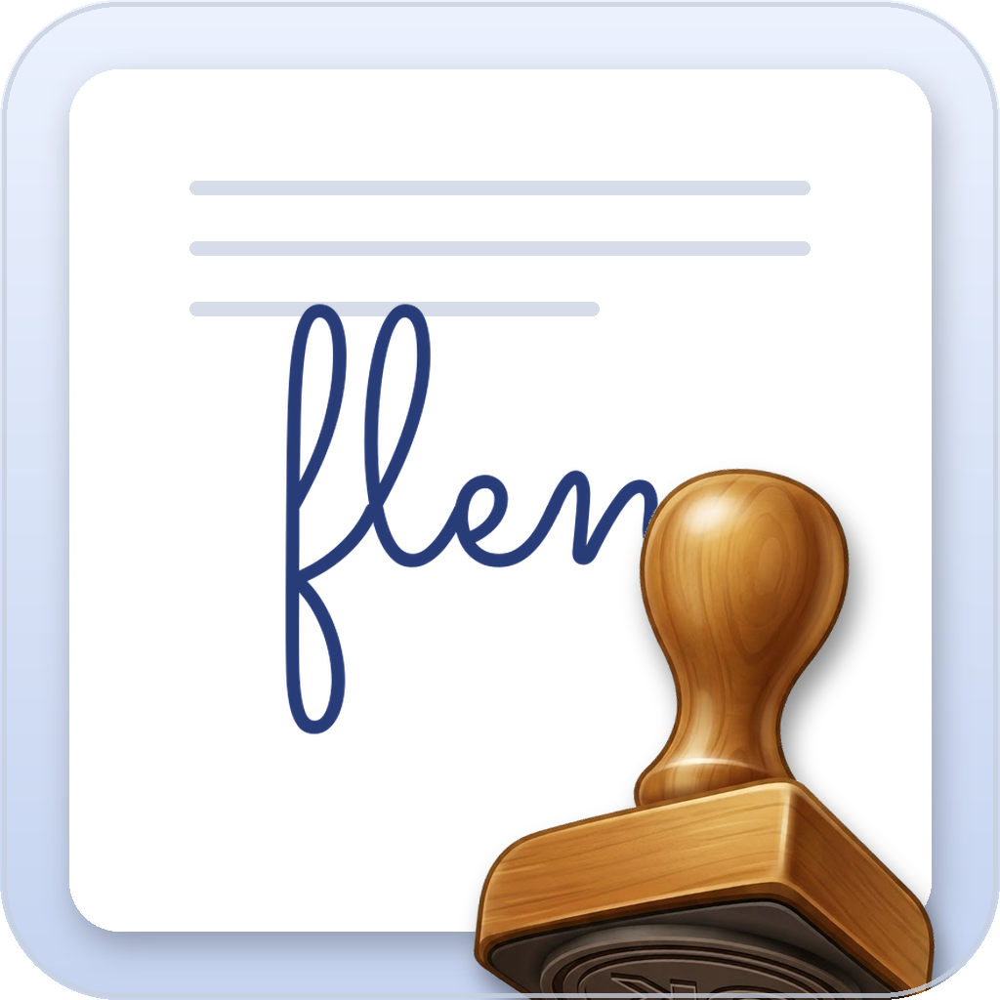

# elen

  

  <strong>Sign PDFs with a date and signature stamp.</strong>

  

elen is a small macOS app for signing PDFs. Open a document, drop a **date** or
**signature** stamp on the page, and save a new signed copy. No account, no
technical knowledge required.

## Download

[Download the latest release](../../releases/latest) — a notarized `.dmg` for
macOS 14 or newer.

## How it works

1. **Open document** — choose the PDF you want to sign.
2. Pick the **Date** or **Signature** stamp from the tray and move it over the
   page. The stamp follows the mouse and previews exactly where it will land;
   click to place it.
3. Adjust a placed stamp by dragging it, and resize it using the handles on the
   dashed box.
4. **Save PDF** — writes a new signed file next to the original. The original
   is never modified.

## Features

- **Date stamp** (today) and **signature stamp**.
- **Signature library**: store several signatures and pick one from a dropdown.
  Add a new one by **drawing** with the trackpad or **scanning** it with the
  camera.
- Choose the **ink color** and **stamp size**.
- Live preview of placement before you click.
- Always saves a **new** file (`...-firmado.pdf`), leaving the source untouched.

## License

MIT — see [LICENSE](LICENSE).
